# RetailPulse – AI-Powered Customer Analytics & Demand Forecasting Platform

  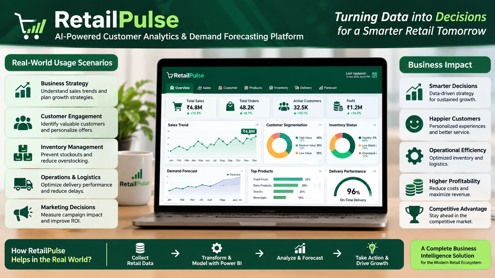

<h3 align="center">Turning Retail Data into Smarter Business Decisions</h3>

  A Business Intelligence & Retail Analytics Portfolio Project

  
  
  
  

---

## Project Overview

**RetailPulse** is an interactive Business Intelligence platform developed using Microsoft Power BI as part of the **Zidio Internship Project**.

The project transforms raw retail operational data into meaningful business insights through data cleaning, transformation, semantic modeling, DAX calculations, and interactive visualizations.

Using the Blinkit Retail Analytics Dataset, RetailPulse integrates nine interconnected CSV datasets to provide a centralized analytical environment for understanding sales performance, customer behaviour, product contribution, store operations, financial performance, inventory risks, and delivery efficiency.

The platform features 11 interactive dashboard pages, 32 core DAX measures, a dedicated calendar engine, and Power BI's built-in forecasting capabilities.

The primary objective is to demonstrate how Business Intelligence can help retail organizations monitor performance, identify operational challenges, and make informed, data-driven decisions.

## Project Information

| Attribute | Details |
|---|---|
| Project Name | RetailPulse – AI-Powered Customer Analytics & Demand Forecasting Platform |
| Organization | Zidio Internship Project |
| Developer | Harsh Sindhal |
| Role | Data Analyst / Power BI Developer |
| Duration | 15 October 2026 – 12 November 2026 |
| Project Type | Business Intelligence & Data Analytics |
| Primary Tool | Microsoft Power BI Desktop |
| Data Transformation | Power Query |
| Analytical Engine | DAX |
| Data Architecture | Star Schema |
| Dashboard Pages | 11 |
| Core DAX Measures | 32 |

## Business Objectives

RetailPulse addresses the challenge of analyzing fragmented retail information by integrating multiple operational datasets into a unified analytical model.

The project aims to:

- Centralize retail information from multiple CSV datasets.
- Improve data quality through structured ETL transformations.
- Develop a reliable relational data model.
- Analyze sales and revenue performance across different periods.
- Understand customer purchasing patterns and customer value.
- Evaluate product and store performance.
- Monitor inventory levels and identify stock-related risks.
- Analyze delivery efficiency and delay patterns.
- Provide executive-level insights through interactive dashboards.
- Support forward-looking analysis using Power BI forecasting.

## Technology Stack

| Category | Technology | Purpose |
|---|---|---|
| Business Intelligence | Microsoft Power BI Desktop | Dashboard development and reporting |
| Data Transformation | Power Query | ETL, cleaning, normalization, and validation |
| Analytical Calculations | DAX | Measures, KPIs, and business logic |
| Data Modeling | Star Schema | Structured relational architecture |
| Visualization | Power BI Native Visuals | Interactive charts, cards, slicers, and tables |
| Forecasting | Power BI Analytics Forecast | Historical time-series forecasting |
| Business Recommendations | DAX SWITCH | Dynamic recommendation logic |
| Data Source | CSV Files | Retail operational datasets |

## Dataset Description

The project uses the Blinkit Retail Analytics Dataset, consisting of nine CSV files.

| Dataset | Description |
|---|---|
| blinkit_customer_feedback | Customer feedback and ratings |
| blinkit_customers | Customer information and registration details |
| blinkit_delivery_performance | Delivery and logistics information |
| blinkit_inventory | Original inventory records |
| blinkit_inventoryNew | Additional inventory records |
| blinkit_marketing_performance | Marketing impressions, clicks, and conversions |
| blinkit_order_items | Individual products purchased within orders |
| blinkit_orders | Order-level transactional information |
| blinkit_products | Product catalog and pricing information |

**Inventory Consolidation:** Both inventory datasets were validated and appended into a master table named `blinkit_inventory_combined`, containing 74,750 records.

A Left Anti Join on `product_id` and `date` returned all 9,215 records from `blinkit_inventoryNew`, confirming no matching records against the original inventory table on those selected keys.

## Data Preprocessing & ETL

Power Query served as the primary ETL engine throughout the project.

**1. Data Type Normalization**

Identification and contact-related fields, including `customer_id`, `order_id`, `product_id`, `delivery_partner_id`, `store_id`, `phone`, and `pincode`, were converted to Text to preserve identifier integrity and leading zeros.

**2. Duplicate Validation**

Primary-key columns were examined using Power Query's Keep Duplicates functionality. Zero duplicate records were identified in the examined primary-key fields.

**3. Inventory Deduplication**

Exact duplicate records across four columns were removed from `blinkit_inventoryNew`.

**4. Inventory Consolidation**

Both inventory datasets were appended into `blinkit_inventory_combined`, creating a unified inventory table containing 74,750 rows.

**5. Data Quality Validation**

Column profiling was used to inspect null values, numerical ranges, and data consistency.

Business-specific values were preserved, including null delay reasons associated with on-time deliveries and negative delivery-time differences representing early deliveries.

**6. Feature Engineering**

The following custom columns were created:

- `Total_Item_Value` – Quantity multiplied by unit price.
- `Click_Through_Rate` – Clicks divided by impressions, multiplied by 100, with zero-impression protection.
- `Customer_Value_Category` – Classifies customers into High Value, Medium Value, and Low Value.
- `Click_Check` – Marketing click validation.
- `Conversion_Check` – Marketing conversion validation.
- `Spend_Check` – Marketing spend validation.

## Data Modeling – Star Schema

RetailPulse uses a structured relational data model to connect the different business entities.

The model includes relationships between customers, orders, products, order items, delivery performance, customer feedback, inventory, and marketing information.

A dedicated DAX DateTable provides centralized time intelligence.

**Calendar Coverage:** 01 January 2023 – 31 December 2026.

The calendar includes Date, Year, Month Number, Month, Quarter, Year-Month, Day, and Day Name.

The DateTable connects to orders, combined inventory, and marketing performance through active relationships. Inactive date relationships are maintained for customer registration and feedback dates.

## Dashboard Architecture

RetailPulse contains 11 interactive dashboard pages, each designed around a specific business intelligence domain.

| Page | Dashboard | Purpose |
|---|---|---|
| 01 | Executive Summary | Overall business performance and KPIs |
| 02 | Sales Trend | Historical revenue and sales trends |
| 03 | Product Performance | Product and category analysis |
| 04 | Customer Analytics | Customer value and segmentation |
| 05 | Store Performance | Store-level business comparisons |
| 06 | Monthly & Seasonal Sales | Monthly, yearly, and seasonal analysis |
| 07 | Customer Behaviour | Customer purchasing patterns |
| 08 | Profit & Revenue | Financial and discount analysis |
| 09 | Inventory Analysis & Risk | Stock monitoring and inventory classification |
| 10 | Delivery & Logistics | Delivery efficiency and delay analysis |
| 12 | Executive Intelligence & Outlook | Forecasting and dynamic DAX recommendations |

*Note: The final module is the eleventh dashboard page but retains the Page 12 label from the project specification.*

## Key Features

- **Multi-Source Integration:** Combines nine retail datasets into a unified analytical environment.
- **Data Quality Validation:** Performs duplicate checks, type normalization, and column profiling.
- **Inventory Consolidation:** Creates a 74,750-row combined inventory table.
- **Customer Segmentation:** Categorizes customers based on average order value.
- **Sales Intelligence:** Analyzes revenue, orders, and historical trends.
- **Product Analytics:** Identifies product and category performance.
- **Store Analytics:** Enables store-level performance comparisons.
- **Financial Analysis:** Provides revenue and discount-related insights.
- **Inventory Risk Monitoring:** Classifies stock into Low Stock, Healthy Stock, and Overstock.
- **Delivery Analytics:** Evaluates delivery performance and delay-related indicators.
- **Time Intelligence:** Supports chronological monthly and yearly comparisons.
- **Executive Forecasting:** Uses Power BI Analytics Forecast functionality.
- **Dynamic Recommendations:** Implements DAX SWITCH-based business recommendations.
- **Interactive Reporting:** Provides slicers, KPI cards, charts, tables, and cross-filtering.

## DAX Measure Library

The project incorporates 32 core DAX measures covering multiple analytical categories.

These measures support sales and revenue calculations, order performance, product contribution, customer analytics, store performance, financial analysis, inventory monitoring, delivery performance, marketing metrics, time intelligence, and executive recommendations.

The measures are designed to respond dynamically to report filter context and slicer selections.

## Dashboard Design

The report follows a consistent widescreen 16:9 layout with a dark green visual theme.

**Primary Theme Color:** `#1D8F5F`

The design focuses on visual consistency, readability, interactive filtering, meaningful KPI presentation, and business-oriented reporting.

## Project Screenshots

### Executive Summary

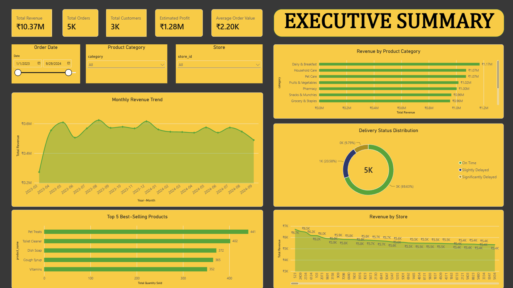

### Sales Trend

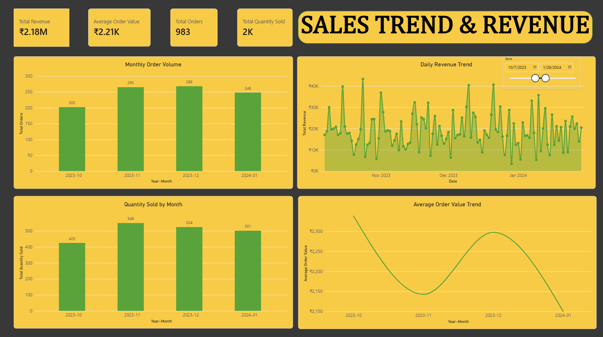

### Product Performance

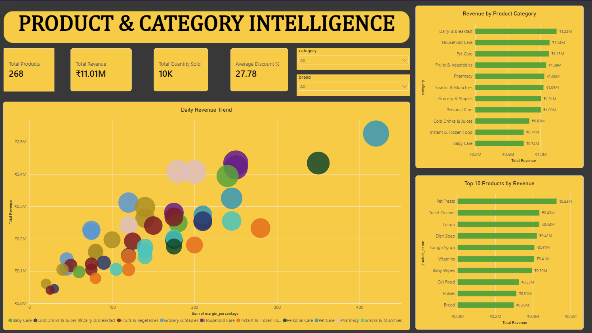

### Customer Analytics

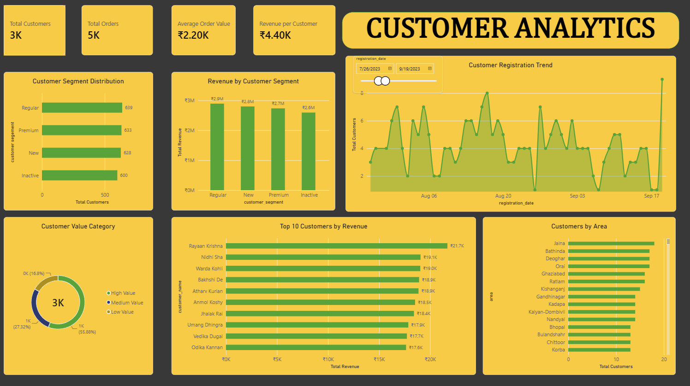

### Store Performance

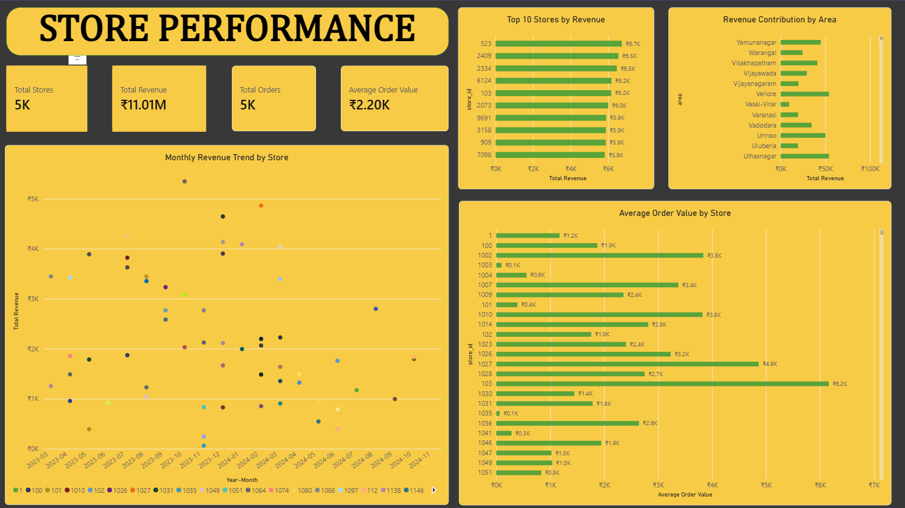

### Monthly & Seasonal Sales

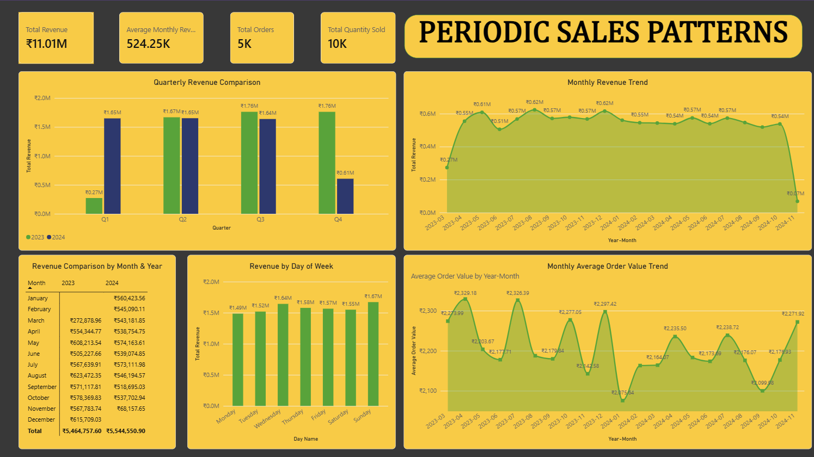

### Customer Behaviour

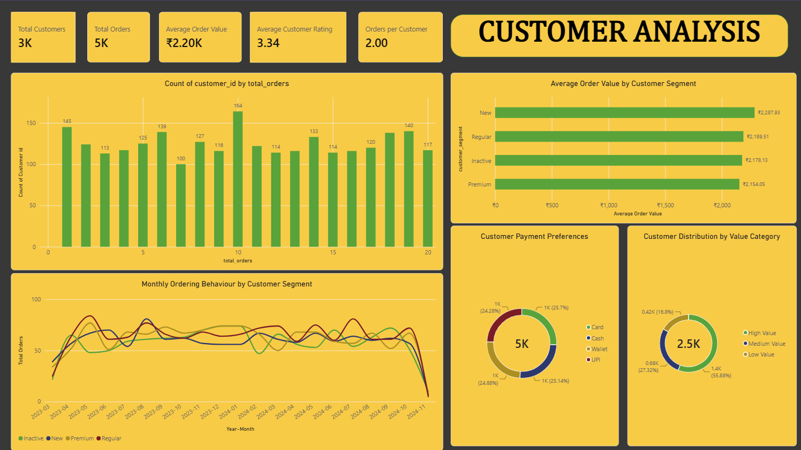

### Profit & Revenue

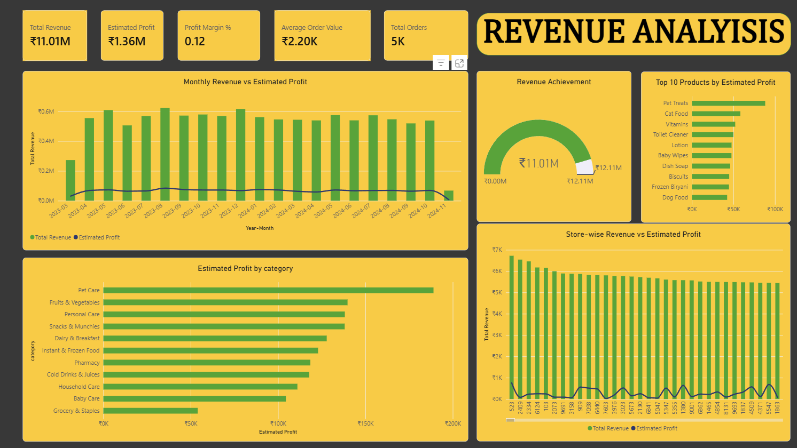

### Inventory Analysis & Risk

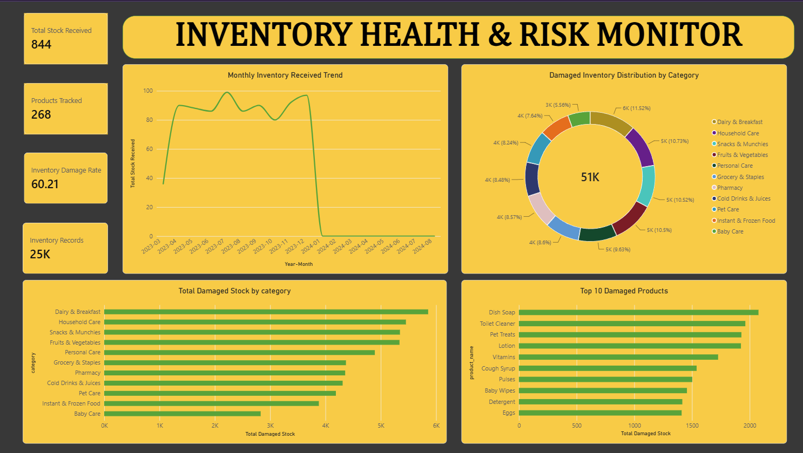

### Delivery & Logistics

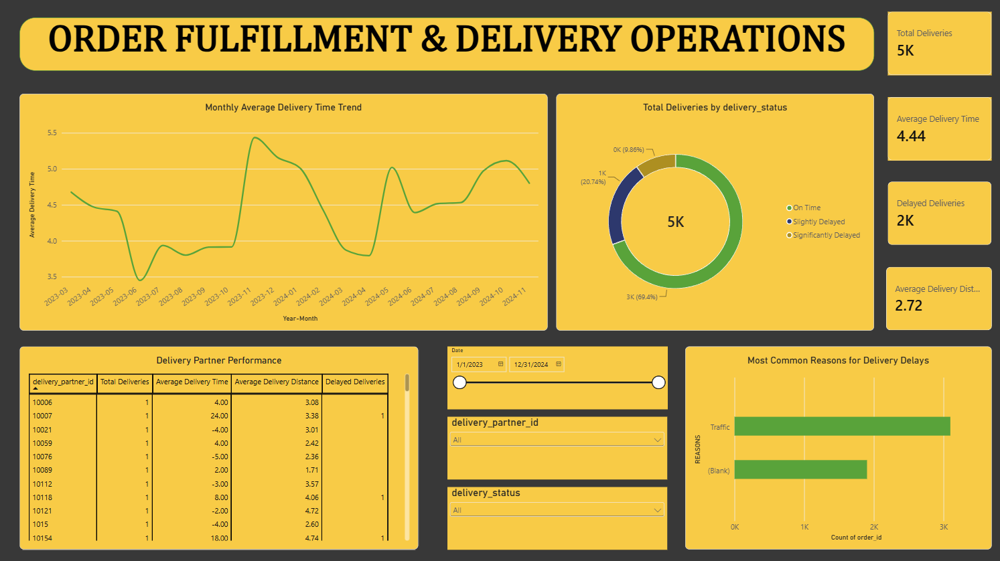

### Executive Intelligence & Outlook

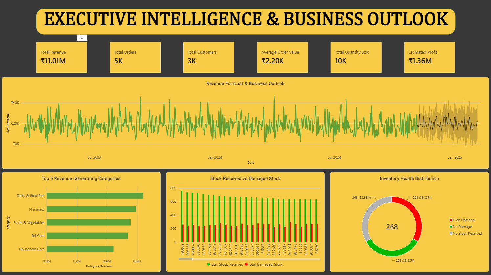

## Technical Challenges & Solutions

| Challenge | Solution |
|---|---|
| Incorrect data types for identifiers | Converted identification fields to Text |
| Duplicate source records | Applied duplicate validation and removal |
| Inventory overlap validation | Used Left Anti Join |
| Multiple inventory sources | Appended both datasets |
| Ambiguous relationship paths | Configured inactive relationships where required |
| Incorrect month sorting | Used Month Number and chronological sorting logic |
| Missing historical records | Preserved actual source-data coverage |
| Business-specific null values | Retained valid nulls in delay-related fields |
| Inventory classification | Implemented conditional stock-status categories |
| Dynamic analytical requirements | Developed reusable DAX measures |

## Real-World Business Applications

RetailPulse demonstrates how retail organizations can use Business Intelligence to monitor sales and revenue performance, identify high-value customer groups, understand product demand, identify potential stock shortages and overstocking, evaluate delivery performance, compare store operations, analyze seasonal purchasing patterns, and support management decisions through executive reporting.

## Live Project & Repository

### Live Power BI Dashboard

Explore the interactive RetailPulse dashboard, including its 11 analytical report pages, KPI cards, filters, visualizations, and executive insights.

**[View Live RetailPulse Dashboard](https://app.powerbi.com/view?r=eyJrIjoiMGE3ZmI3YmUtMGJlOS00ZTdmLWIwN2EtYjdkZDIxYzM5MTljIiwidCI6IjM0YmQ4YmVkLTJhYzEtNDFhZS05ZjA4LTRlMGEzZjExNzA2YyJ9&pageName=3786165053b9e7811dd2)**

### GitHub Repository

Access the project repository containing the Power BI source file, project documentation, and supporting resources.

**[View GitHub Repository – RetailPulse-PowerBI-Analytics](https://github.com/harshsindhal/RetailPulse-PowerBI-Analytics)**

## Conclusion

RetailPulse demonstrates the practical application of Business Intelligence through data integration, ETL engineering, semantic modeling, DAX calculations, and interactive dashboard development.

By combining nine retail datasets, 32 core DAX measures, and 11 analytical dashboard pages, the project transforms raw operational information into meaningful business insights.

It showcases practical problem-solving, analytical thinking, and the ability to develop structured reporting solutions that support retail performance monitoring and data-driven decision-making.

**RetailPulse represents my practical capabilities as a Data Analyst and Power BI Developer, demonstrating how complex datasets can be transformed into actionable business intelligence.**

---

## Developer

**Harsh Sindhal**  
Data Analyst | Power BI Developer

- **LinkedIn:** https://linkedin.com/in/harsh-sindhal
- **GitHub:** https://github.com/harshsindhal
- **Email:** harshsindhal123@gmail.com

**Organization:** Zidio Internship Project

  RetailPulse – Turning Data into Decisions.

